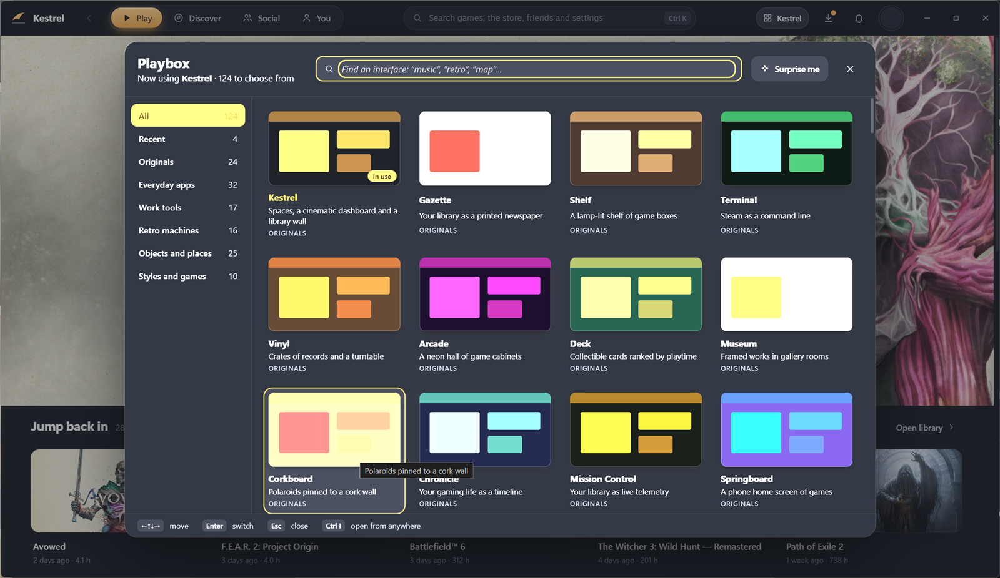

# Playbox Theme

The companion theme for **[Playbox](https://github.com/OriginalSwayze/Playbox)**, a Millennium plugin with 124
switchable interfaces for Steam. The plugin replaces how you move around Steam; this theme dresses the parts that
stay Steam's own (pages, dialogs, settings, menus, notifications, friends and chat, sign-in, and the Store and
Community) in deep ink and amber so they match.

## Install
- **From Millennium:** find **Playbox** in Millennium's theme browser and install it.
- **By hand:** put this folder in `Steam\millennium\themes\Playbox\`, then choose **Playbox** in Millennium's
  theme settings.

For the interfaces themselves, install the Playbox plugin (see its
[README](https://github.com/OriginalSwayze/Playbox#install-all-in-one)). The theme works without the plugin, and the
plugin works without the theme.

## Options (in Millennium's theme settings)
- **Motion:** Full, Calm (hovers only) or Still.
- **Contrast:** Normal or High (solid panels and brighter secondary text).
- And more: text size, focus rings, compact lists, cover effects and a privacy mode, among others.

## Source
This folder is built from `skin-src/` in the [Playbox repository](https://github.com/OriginalSwayze/Playbox).

## License
MIT. See [LICENSE](LICENSE).
